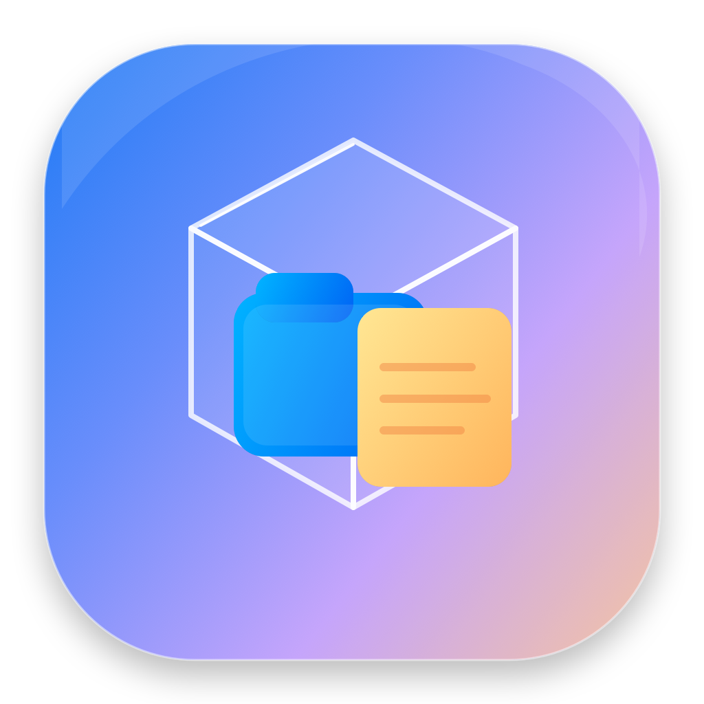

<p align="center">
  
</p>

<h1 align="center">DeskBox</h1>

<p align="center">
  <strong>把 macOS 桌面变成一个真正可整理、可切换、可恢复的工作空间。</strong>
</p>

<p align="center">
  原生 macOS 桌面整理工具 · Swift + SwiftUI + AppKit · 免费开源
</p>

<p align="center">
  <a href="https://github.com/403528287/DeskBox/releases/latest">
    
  </a>
  <a href="https://github.com/403528287/DeskBox/releases">
    
  </a>
  <a href="https://github.com/403528287/DeskBox/stargazers">
    
  </a>
  <a href="LICENSE">
    
  </a>
  
  
</p>

<p align="center">
  <a href="https://github.com/403528287/DeskBox/releases/download/v0.1.1/DeskBox-v0.1.1-macOS-universal.dmg"><strong>⬇️ 下载 DeskBox v0.1.1 DMG</strong></a>
  ·
  <a href="https://github.com/403528287/DeskBox/releases/tag/v0.1.1">查看 Release</a>
</p>

---

## DeskBox 是什么？

DeskBox 是一个原生 macOS 桌面整理工具。

它不是简单把桌面文件“藏起来”，而是把 **文件分区、工作区、便签、待办、快捷入口** 放在同一个桌面工作流里，让正在处理的文件和事情更容易找到，也更容易恢复。

如果你喜欢 Fences 一类的桌面整理方式，但希望在 macOS 上拥有更原生、更轻量、可开源修改的方案，DeskBox 就是为这个方向做的。

### 一眼看懂

| 能力 | DeskBox |
| --- | --- |
| 🗂️ 文件分区 | 把桌面文件拖入分区，真实收纳到对应文件夹 |
| ↔️ 原生拖拽 | 分区间移动、分区内手动排序、多选 |
| ⌘Z 撤销 | DeskBox 文件移动支持撤销，并保留最近操作 |
| 🧩 桌面组件 | 便签、待办清单、网站 / 文件夹 / App 快捷入口 |
| 🖥️ 多工作区 | 不同工作区独立组织组件和布局 |
| 🔒 布局锁定 | 防止误拖动，支持布局快照与恢复 |
| 💾 配置备份 | JSON 导出 / 恢复，不打包真实文件 |
| 🛟 安全恢复 | 异常退出快照、配置损坏隔离、缺失目录保护 |
| 🍎 原生体验 | 菜单栏常驻、Quick Look、原生文件图标、玻璃界面 |
| 💻 Universal | 同一个安装包支持 Apple Silicon 和 Intel Mac |

> **当前版本：0.1.1**
>
> DeskBox 仍处于早期开发阶段，欢迎试用、Star、提交 Issue 和 Pull Request。

---

## 下载与安装

### 推荐：DMG

**[⬇️ 下载 DeskBox v0.1.1 DMG](https://github.com/403528287/DeskBox/releases/download/v0.1.1/DeskBox-v0.1.1-macOS-universal.dmg)**

也可以下载：

- [DeskBox v0.1.1 ZIP](https://github.com/403528287/DeskBox/releases/download/v0.1.1/DeskBox-v0.1.1-macOS-universal.zip)
- [全部 Releases](https://github.com/403528287/DeskBox/releases)

系统要求：

- macOS 14.0 或更高版本
- Apple Silicon 或 Intel Mac

### 第一次打开

DeskBox 是一个免费开源练习项目，目前没有购买 Apple Developer Program，因此 Release 使用 **ad-hoc 签名**，没有 Apple Developer ID 公证。

第一次运行时 macOS 可能阻止打开：

1. 把 DeskBox 拖入“应用程序”。
2. 在 Finder 中找到 DeskBox，**右键 → 打开**。
3. 再次确认“打开”。
4. 如果仍被阻止：**系统设置 → 隐私与安全性 → 仍要打开**。

只建议运行从本仓库 Releases 下载，或自行从源码构建的版本。

---

## 功能

### 🗂️ 文件分区

- 从桌面 / Finder 拖入文件和文件夹
- 分区之间直接移动
- 分区内部手动排序
- 多选
- Quick Look 预览
- Finder 中显示
- 同名文件不会被覆盖

### ⌘Z 文件移动撤销

DeskBox 会记录由应用执行的文件移动。

- `⌘Z` 撤销最近一次文件移动
- 批量移动按一次操作记录
- “最近操作”页面可以追溯历史
- 撤销时仍然不会覆盖已有同名文件

### 📝 便签与待办

- 桌面便签
- 待办清单
- 折叠 / 固定
- 自由移动和调整大小
- 状态自动保存

### 🔗 快捷入口

可添加：

- 网站
- 文件
- 文件夹
- App

快捷入口只是引用，**不会移动或复制目标文件**。目标失效后会显示“已失效”。

### 🖥️ 工作区

- 创建多个工作区
- 一键切换
- 组件跨工作区移动
- 工作区布局锁定
- 保存 / 恢复布局快照

工作区只改变 DeskBox 内的组织关系，**不会因为切换工作区而移动真实文件**。

---

## 重要：文件是如何存储的

DeskBox 的“文件分区”不是快捷方式列表。

当你把文件拖入某个分区时，文件会**真实移动**到：

```text
~/Documents/DeskBox/<分区名称>/
```

例如：

```text
~/Documents/DeskBox/临时文件/
~/Documents/DeskBox/正在处理/
```

为了保护文件：

- 重名时自动生成 `文件 2.ext`、`文件 3.ext` 等，不覆盖原文件
- 分区文件夹被 Finder 外部改名 / 移动后，DeskBox 不会偷偷创建一个同名空目录
- 删除非空分区前，文件必须先安全移回桌面
- 配置恢复不会删除真实文件
- 便签、待办、快捷入口、工作区属于配置数据，与真实文件分开保存

---

## 配置备份与恢复

在 **设置 → 通用** 中可以导出 JSON 配置备份。

备份包含：

- 工作区
- 分区布局
- 便签
- 待办
- 快捷入口
- 布局快照
- 锁定状态

**配置备份不包含真实文件。**

DeskBox 还会在恢复配置之前自动保留当前配置快照。

---

## 隐私

DeskBox 当前：

- 没有账号系统
- 没有云同步
- 没有遥测上传
- 没有广告
- 文件整理与配置数据都在本机完成

---

## 从源码构建

推荐开发环境：

- macOS 14+
- Xcode 27
- Swift 6

```bash
git clone https://github.com/403528287/DeskBox.git
cd DeskBox
open DeskBox.xcodeproj
```

命令行 Debug 构建：

```bash
xcodebuild \
  -project DeskBox.xcodeproj \
  -scheme DeskBox \
  -configuration Debug \
  -derivedDataPath .build \
  CODE_SIGNING_ALLOWED=NO \
  build
```

---

## 生成本地 Release 安装包

仓库提供免费 Release 脚本：

```bash
./scripts/build-release.sh
```

脚本会：

- 构建 arm64 + x86_64 Universal App
- 做本地 ad-hoc 签名
- 验证 App Bundle
- 生成 ZIP
- 生成带 Applications 快捷入口的 DMG

输出位于：

```text
dist/
```

不会进行 Apple Developer ID 签名或公证。

---

## Roadmap

0.1.x 阶段优先保证：

- 文件安全
- 拖拽稳定性
- 配置恢复
- macOS 原生体验

后续会根据真实使用反馈决定功能，而不是单纯堆功能。

有想法可以直接：

- [提交 Bug](https://github.com/403528287/DeskBox/issues/new?template=bug_report.md)
- [提出功能建议](https://github.com/403528287/DeskBox/issues/new?template=feature_request.md)

---

## Contributing

欢迎贡献代码、文档、Bug 报告和设计建议。

请阅读 [CONTRIBUTING.md](CONTRIBUTING.md)。

如果这个项目对你有点用，或者你也喜欢这个方向，欢迎点一个 ⭐ **Star**。这能让我知道 DeskBox 值得继续做下去。

---

## Security

请不要在公开 Issue 中提交密码、API Key、Apple 证书、真实桌面文件或其他私人数据。

详见 [SECURITY.md](SECURITY.md)。

---

## License

MIT License，见 [LICENSE](LICENSE)。
